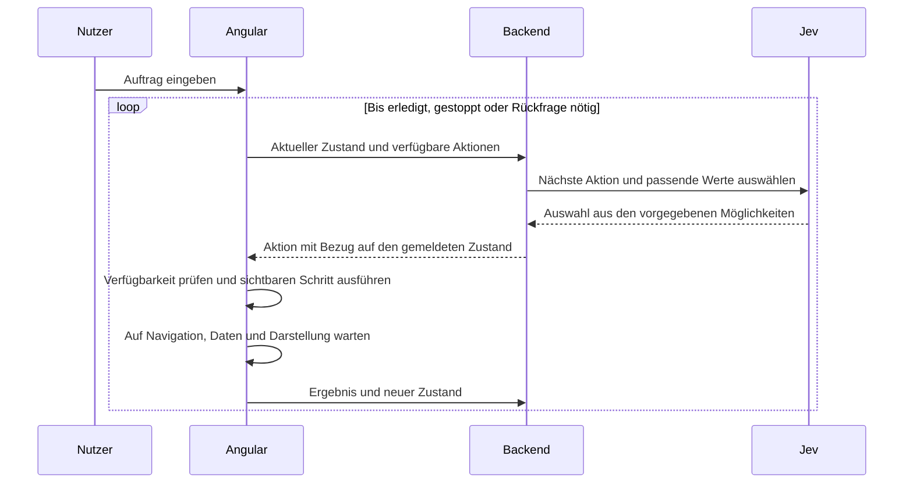

# Oberfläche und Bedienassistenz

Die Anwendung verwaltet Aufgaben, Kunden und Berichte. Nutzer können sie direkt bedienen oder Jev einen Auftrag in natürlicher Sprache geben. Jev führt die Schritte zügig in der sichtbaren Oberfläche aus. Ein Verlauf hält ausgeführte Schritte und Ergebnisse fest.

## Festgelegtes Verhalten

- Jev verwendet die aktuell zugänglichen Bedienelemente. Benötigte Menüs und Dialoge werden sichtbar geöffnet.
- Nach Navigation und jeder Änderung der verfügbaren Aktionen meldet das Frontend den neuen Zustand.
- Änderungen dürfen gespeichert werden, wenn der ursprüngliche Nutzerauftrag das verlangt.
- Feldwerte stammen aus dem Auftrag oder aus vorhandenen Daten. Es gibt keine freie Textgenerierung und kein zusätzliches Sprachmodell.
- Der Ablauf hat einen erreichbaren Stopp-Schalter. Ein Stopp verhindert weitere Schritte; er macht bereits gespeicherte Änderungen nicht rückgängig.
- Die Gestaltung soll seriös, modern und über alle Seiten zusammenhängend sein. Die konkrete visuelle Richtung wird anhand von drei Designstudien ausgewählt.

## Vorgeschlagene UI-Basis

Das vorhandene Angular-Lab verwendet handgeschriebenes CSS. Eine Component Library, Tailwind, Tabellen- und Chart-Bibliotheken sind noch nicht installiert.

| Baustein | Vorschlag | Aufgabe |
| --- | --- | --- |
| Komponenten | Spartan UI | Zugängliche Bedienelemente und anpassbarer Komponentencode. |
| Styling | Tailwind CSS 4 | Layout und Styles auf gemeinsamen semantischen Design-Tokens. |
| Tabellen | TanStack Angular Table | Filter, Sortierung, Auswahl und Tabellenzustand; die Darstellung gehört zum Designsystem. |
| Diagramme | TanStack Charts mit Angular-Adapter | Berichte mit gemeinsamen Farben, Schriftgrößen und Auswahlzuständen. |
| Serverdaten | Bestehendes TanStack Angular Query | Abfragen und Mutationen über den vorhandenen oRPC-WebSocket. |

Spartan trennt das Verhalten in `brain` von den ins Projekt übernommenen `helm`-Komponenten. Dadurch lässt sich ein eigenes Designsystem aufbauen. Übernommener Komponentencode muss bei Bibliotheksupdates bewusst mitgepflegt werden. [Installation](https://www.spartan.ng/documentation/installation), [Theming](https://www.spartan.ng/documentation/theming).

PrimeNG ist eine Alternative mit vielen fertigen Fachkomponenten. Spartan passt besser zur geplanten eigenen Darstellung und zur unabhängigen TanStack-Tabelle. Angular Aria und CDK direkt würden mehr eigene Komponentenarbeit verlangen. Es ist keine Mischung mehrerer vollständiger Component Libraries vorgesehen.

Die Paketmetadaten wurden am 20. September 2026 geprüft. Spartan `1.4.1` unterstützt Angular 21 und 22 sowie Tailwind ab Version 4. TanStack Angular Table `9.2.4` unterstützt Angular ab Version 19. TanStack Charts `0.18.0` enthält einen Angular-Einstieg unter `@tanstack/charts/angular`. Charts ist noch als Alpha gekennzeichnet. Diese Prüfung ersetzt keinen Installationstest. [Spartan-Paket](https://registry.npmjs.org/@spartan-ng/brain), [Table-Paket](https://registry.npmjs.org/@tanstack/angular-table), [Charts-Paket](https://registry.npmjs.org/@tanstack/charts), [Angular-Chart-Anleitung](https://github.com/TanStack/charts/tree/main/packages/angular-charts).

## Ein gemeinsames Designsystem

Ein lokaler Ordner `frontend/src/ui/` soll die übernommenen und eigenen UI-Komponenten enthalten. Ein zentraler Token-Satz definiert Oberflächen, Textfarben, Akzent- und Statusfarben, Fokus, Typografie, Abstände, Radien, Schatten und Bewegung. Tailwind bildet diese Werte ab. Fachseiten verwenden gemeinsame Varianten und Muster.

Zu den gemeinsamen Mustern gehören Tabellenkopf, Filterleiste, aktive Filter, Formularfelder mit Fehlern, Detailansicht, Dialoge, Lade- und Leerzustände sowie der Auftragsbereich mit Schrittverlauf. Die Chart-Farben kommen aus denselben Tokens. Eine neue Seite erhält keine eigene unabhängige Farb- oder Abstandsskala.

Eine lokale Katalogseite soll alle Komponenten und ihre Zustände zeigen. Browserprüfungen decken Tastaturbedienung, Fokus, schmale Ansichten und die gemeinsamen Arbeitsabläufe ab. Nach Auswahl des Entwurfs werden Palette, Schrift, Dichte und Varianten verbindlich festgelegt.

## Entscheidungsablauf

Der Zustand umfasst die aktuelle Seite, offene Menüs und Dialoge, relevante Feldwerte, aktive Filter, Ladezustände und ausführbare Aktionen. Jede Aktion hat eine stabile ID. Menschliche Bedienung und Jev verwenden dieselben Komponentenaktionen. Das Öffnen eines Menüs ist ein eigener Schritt und macht dessen Einträge erst anschließend verfügbar.

Eine Zustandsrevision verhindert, dass eine verspätete Entscheidung auf einer bereits geänderten Seite ausgeführt wird. Lauf- und Schritt-IDs verhindern doppelte Ausführung desselben Schritts. Zu jedem Zeitpunkt ist höchstens ein Schritt in Ausführung. Der Verlauf bestätigt Ergebnisse erst nach der Ausführung. Bei einem verlorenen Ergebnis wird eine Speicherung nicht blind wiederholt.

Jev bietet `Choice`, `Score` und `Noul`. Es erzeugt keine beliebigen Funktionsargumente. Für geschlossene Auswahlwerte passt das dokumentierte Function-Calling-Muster. Für wörtliche Werte aus einem Auftrag stellt der Anwendungscode Textkandidaten bereit, zwischen denen Jev auswählt. Zahlen, Datumsangaben und Namen benötigen passende Kandidatensuche und Validierung. Unklare Zuordnungen führen zu einer Rückfrage. [Function Calling](https://docs.typesafe.ai/cookbooks/function_calling), [Werte aus Textkandidaten auswählen](https://docs.typesafe.ai/cookbooks/pre_parsed_value_extraction_cookbook).

Unabhängige Fragen können gemeinsam gestellt werden. Entscheidungen, die neue UI-Zustände benötigen, erfolgen nach der Ausführung in weiteren Aufrufen. Ein Modellwert allein bestätigt weder die tatsächliche Ausführung noch fachliche Berechtigungen. [TypeSafe-Grundmodell](https://docs.typesafe.ai/introduction).

Als Ausgangspunkt soll ein manueller Eingriff den Lauf pausieren. Wiederholte Schritte ohne Fortschritt, fehlende Aktionen und erreichte Laufgrenzen beenden ihn mit einer konkreten Meldung. Diese Regeln gehören zur späteren Umsetzung; aktuell existiert nur die einzelne Textauswertung des Labs.

## Designstudien

Die drei Studien vergleichen eine kompakte helle Arbeitsansicht mit Assistenz rechts, eine luftigere Ansicht mit Auftragseingabe unten und einen dunklen Leitstand mit Verlauf links. Sie verwenden dieselben Beispieldaten und denselben simulierten Ablauf. Sie sind keine produktive Angular-Implementierung.

Die Gestaltung verwendet den öffentlich bereitgestellten [Frontend-Design-Skill von Anthropic](https://github.com/anthropics/skills/tree/main/skills/frontend-design). Der Skill wurde für diese Untersuchung gelesen; er ist nicht global installiert.
