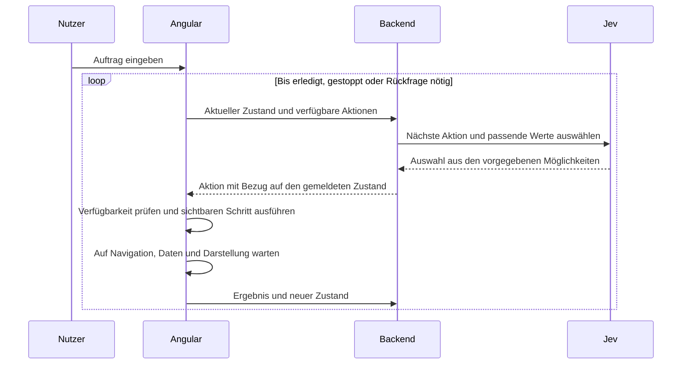

# Oberfläche und Bedienassistenz

Die Anwendung verwaltet Aufgaben, Kunden und Berichte. Nutzer können sie direkt bedienen oder Jev einen Auftrag in natürlicher Sprache geben. Jev führt die Schritte zügig in der sichtbaren Oberfläche aus. Ein Verlauf hält ausgeführte Schritte und Ergebnisse fest.

## Festgelegtes Verhalten

- Jev verwendet die aktuell zugänglichen Bedienelemente. Benötigte Menüs und Dialoge werden sichtbar geöffnet.
- Nach Navigation und jeder Änderung der verfügbaren Aktionen meldet das Frontend den neuen Zustand.
- Änderungen dürfen gespeichert werden, wenn der ursprüngliche Nutzerauftrag das verlangt.
- Feldwerte stammen aus dem Auftrag oder aus vorhandenen Daten. Es gibt keine freie Textgenerierung und kein zusätzliches Sprachmodell.
- Der Ablauf hat einen erreichbaren Stopp-Schalter. Ein Stopp verhindert weitere Schritte; er macht bereits gespeicherte Änderungen nicht rückgängig.
- Gewählt ist Design A mit heller Arbeitsfläche, dunkler linker Navigation und kompakten Tabellen. Ein per Tastenkürzel geöffnetes Auftragsfenster mit integriertem Verlauf ersetzt die dauerhafte Jev-Spalte.

## UI-Basis

Die Anwendung verwendet Spartan Brain für den modalen Auftragsdialog, Tailwind CSS 4 und TanStack Angular Table. Eigene Angular-Komponenten gestalten Vorgangstabelle, Detailformular, Übersichten und Palette mit gemeinsamen Tokens und CSS-Klassen.

| Baustein | Auswahl | Aufgabe |
| --- | --- | --- |
| Komponenten | Spartan Brain und eigene Angular-Komponenten | Dialogverhalten, Fokusverwaltung und die konkrete Kontor-Oberfläche. |
| Styling | Tailwind CSS 4 | Layout und Styles auf gemeinsamen semantischen Design-Tokens. |
| Tabellen | TanStack Angular Table | Filter, Sortierung, Auswahl und Tabellenzustand; die Darstellung gehört zum Designsystem. |
| Diagramme | TanStack Charts mit Angular-Adapter, geplant | Später interaktive Berichte mit gemeinsamen Farben und Auswahlzuständen. Die erste Berichtsansicht verwendet einfache Kennzahlen und Balken. |
| Serverdaten | Bestehendes TanStack Angular Query | Abfragen und Mutationen über den vorhandenen oRPC-WebSocket. |

Spartan trennt das Verhalten in `brain` von den ins Projekt übernommenen `helm`-Komponenten. Kontor verwendet derzeit Brain direkt und besitzt seine Gestaltung selbst. Es gibt keine vollständig kopierte Helm-Sammlung. [Installation](https://www.spartan.ng/documentation/installation), [Theming](https://www.spartan.ng/documentation/theming).

PrimeNG ist eine Alternative mit vielen fertigen Fachkomponenten. Spartan passt besser zur geplanten eigenen Darstellung und zur unabhängigen TanStack-Tabelle. Angular Aria und CDK direkt würden mehr eigene Komponentenarbeit verlangen. Es ist keine Mischung mehrerer vollständiger Component Libraries vorgesehen.

Die Paketmetadaten wurden am 20. September 2026 geprüft. Spartan `1.4.1` unterstützt Angular 21 und 22 sowie Tailwind ab Version 4. TanStack Angular Table `9.2.4` unterstützt Angular ab Version 19. TanStack Charts `0.18.0` enthält einen Angular-Einstieg unter `@tanstack/charts/angular`. Charts ist noch als Alpha gekennzeichnet. Diese Prüfung ersetzt keinen Installationstest. [Spartan-Paket](https://registry.npmjs.org/@spartan-ng/brain), [Table-Paket](https://registry.npmjs.org/@tanstack/angular-table), [Charts-Paket](https://registry.npmjs.org/@tanstack/charts), [Angular-Chart-Anleitung](https://github.com/TanStack/charts/tree/main/packages/angular-charts).

## Ein gemeinsames Designsystem

`frontend/src/styles.css` enthält die gemeinsame Gestaltung. Semantische Farben beschreiben Arbeitsfläche, Text, Navigation, Akzent, Erfolg und Fehler. Gemeinsame Klassen definieren Buttons, Felder, Karten, Tabellen, Status und Fokus. Die Fachkomponenten verwenden diese Muster über alle Seiten hinweg.

Zu den gemeinsamen Mustern gehören Tabellenkopf, Filterleiste, aktive Filter, Formularfelder mit Fehlern, Detailansicht, Dialoge, Lade- und Leerzustände sowie der Auftragsbereich mit Schrittverlauf. Die Chart-Farben kommen aus denselben Tokens. Eine neue Seite erhält keine eigene unabhängige Farb- oder Abstandsskala.

Eine lokale Komponentenkatalogseite bleibt ein Ausbauziel. Browserprüfungen prüfen Tastaturbedienung, Fokus, schmale Ansichten und die gemeinsamen Arbeitsabläufe. Design A gibt Palette, Schrift und Dichte vor.

## Auftragsfenster und Verlauf

Gewählt ist die erste Variante mit einem Auftragsfenster nach dem Muster von Spotlight und Raycast. Eingabe und Verlauf stehen im selben Fenster. Es öffnet sich über `⌘K` unter macOS, `Strg+K` unter Windows oder den sichtbaren Button **Jev öffnen**. Das Kürzel gilt innerhalb der fokussierten Anwendung. Ein nicht abgesendeter Entwurf bleibt beim Schließen erhalten.

Der Verlauf gruppiert nach Nutzerauftrag. Jeder Eintrag enthält Auftrag, Zeitpunkt, Status und aufklappbare ausgeführte Schritte. Ein erneutes Öffnen startet keinen Auftrag und wiederholt keine Speicherung. Die Oberfläche verwendet feste Statusmeldungen; sie benötigt keine freie Textgenerierung durch Jev.

Eine neue Rückfrage oder Freigabe öffnet das Fenster automatisch und fokussiert die passende Antwort, Eingabe oder Handlung. Escape schließt dieselbe Rückfrage dauerhaft bis zum bewussten erneuten Öffnen über **Antworten**. Eine spätere neue Rückfrage öffnet das Fenster wieder. Der ausstehende Inhalt bleibt beim Schließen erhalten.

Ein bekannter Zielvorgang wird vor einer vorgangsbezogenen Rückfrage über die sichtbaren Bedienaktionen geöffnet. Ein fremder ungespeicherter Entwurf und ein ausdrücklich widersprüchlicher Filter müssen zuerst geklärt werden. Der Dialog nennt den Vorgang und seinen Kontext. Bei einem fehlenden Prüfbeleg schließt **Prüfbeleg erfassen** den Dialog und setzt den Fokus in das tatsächliche Feld. Die Anleitung im Vorgang nennt die manuellen Schritte bis zum ausdrücklichen Fortsetzen.

Beim Absenden schließt sich das Auftragsfenster. Eine kompakte Statusleiste zeigt den aktuellen Schritt und **Stoppen**, während Jev die Arbeitsfläche bedient. Bereits gespeicherte Änderungen bleiben nach einem Stopp bestehen. `Escape` schließt das Fenster, ohne den Auftrag abzubrechen.

Ein modales Auftragsfenster sperrt die dahinterliegenden Bedienelemente. Deshalb pausiert der Lauf, solange es geöffnet ist. Nach dem Schließen muss das Frontend den aktuellen Zustand erneut melden, bevor Jev weiter entscheidet. Die Umsetzung muss auch ein noch ausstehendes Ergebnis abfangen, damit keine verspätete Aktion hinter dem Modal ausgeführt wird. Fokus bleibt im geöffneten Fenster und kehrt beim Schließen an einen sinnvollen Ort zurück. [WAI-ARIA-Dialogmuster](https://www.w3.org/WAI/ARIA/apg/patterns/dialog-modal/).

Der Verlauf bleibt im Auftragsfenster. Während der Ausführung steht der Arbeitsfläche die volle Breite zur Verfügung. Die alternative Studie mit separat geöffnetem Verlauf ist nicht für die Umsetzung ausgewählt. Beide Studien simulieren den Beispielauftrag und halten den Verlauf nur bis zum Neuladen der Seite.

## Entscheidungsablauf

Der Zustand umfasst die aktuelle Seite, offene Menüs und Dialoge, relevante Feldwerte, aktive Filter, Ladezustände und ausführbare Aktionen. Jede Aktion hat eine stabile ID. Menschliche Bedienung und Jev verwenden dieselben Komponentenaktionen. Das Öffnen eines Menüs ist ein eigener Schritt und macht dessen Einträge erst anschließend verfügbar.

Eine Kennung aus Laufgeneration, Schrittnummer und Datenrevision bindet die Entscheidung an ihren Ausgangszustand. Unterbrechungen ändern die Laufgeneration und entwerten ausstehende Antworten. Zu jedem Zeitpunkt ist höchstens ein Schritt in Ausführung. Der Verlauf bestätigt Ergebnisse erst nach der Ausführung. Operations-IDs und gespeicherte Belege verhindern doppelte Speicherungen bei einem verlorenen Ergebnis.

Jev bietet `Choice`, `Score` und `Noul`. Es erzeugt keine beliebigen Funktionsargumente. Für geschlossene Auswahlwerte passt das dokumentierte Function-Calling-Muster. Für wörtliche Werte aus einem Auftrag stellt der Anwendungscode Textkandidaten bereit, zwischen denen Jev auswählt. Zahlen, Datumsangaben und Namen benötigen passende Kandidatensuche und Validierung. Unklare Zuordnungen führen zu einer Rückfrage. [Function Calling](https://docs.typesafe.ai/cookbooks/function_calling), [Werte aus Textkandidaten auswählen](https://docs.typesafe.ai/cookbooks/pre_parsed_value_extraction_cookbook).

Unabhängige Fragen können gemeinsam gestellt werden. Entscheidungen, die neue UI-Zustände benötigen, erfolgen nach der Ausführung in weiteren Aufrufen. Ein Modellwert allein bestätigt weder die tatsächliche Ausführung noch fachliche Berechtigungen. [TypeSafe-Grundmodell](https://docs.typesafe.ai/introduction).

Ein manueller Eingriff pausiert den Lauf. Fehlende sichere Aktionen und die erreichte Schrittgrenze führen zu einer konkreten Meldung. Neue Aufträge dürfen fremde ungespeicherte Entwürfe nicht übernehmen. Nach Neuladen wird ein unterbrochener Auftrag erst nach erneuter Prüfung ausdrücklich fortgesetzt.

## Designstudien

Die ursprünglichen Studien vergleichen eine kompakte helle Arbeitsansicht mit Assistenz rechts, eine luftigere Ansicht mit Auftragseingabe unten und einen dunklen Leitstand mit Verlauf links. Design A ist ausgewählt. Von den beiden Folgestudien ist die erste Variante mit Eingabe und Verlauf im selben Auftragsfenster ausgewählt. Alle Studien verwenden Beispieldaten und simulierte Abläufe. Sie sind keine produktive Angular-Implementierung.

Die Gestaltung verwendet den öffentlich bereitgestellten [Frontend-Design-Skill von Anthropic](https://github.com/anthropics/skills/tree/main/skills/frontend-design). Der Skill wurde für diese Untersuchung gelesen; er ist nicht global installiert.
